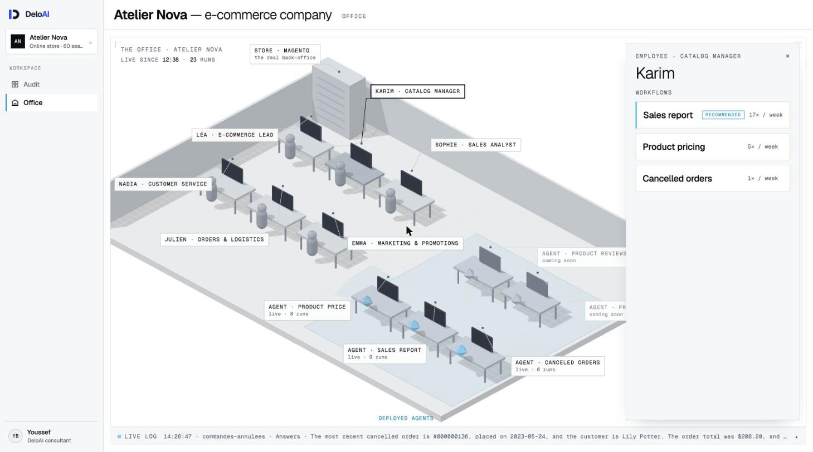
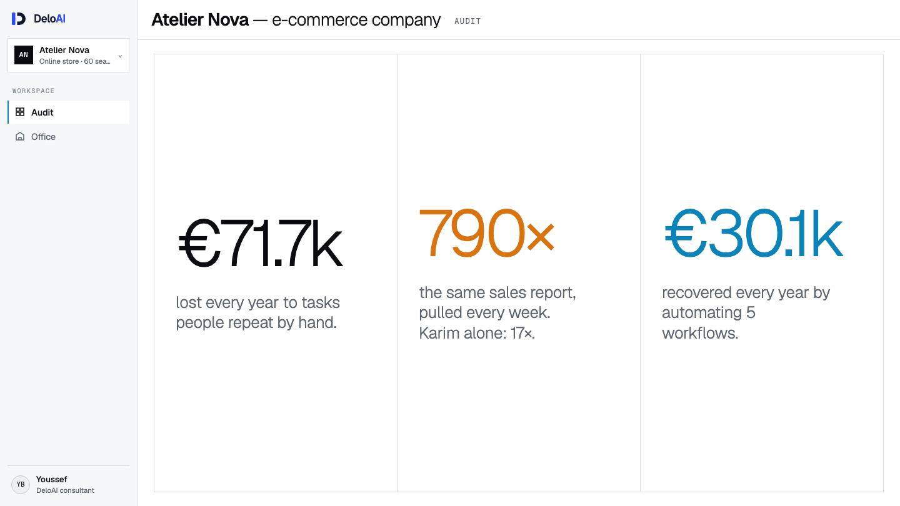
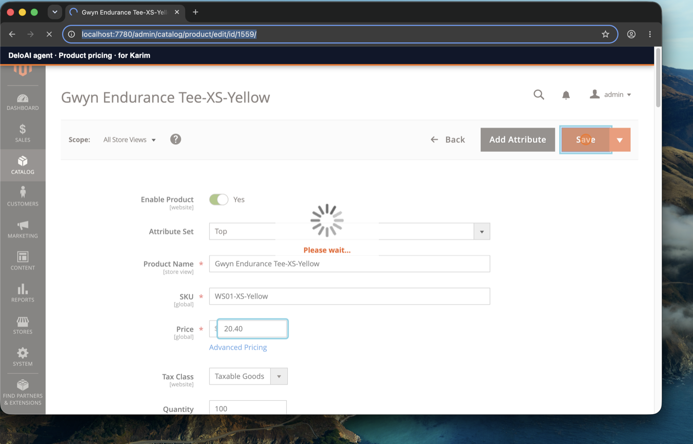
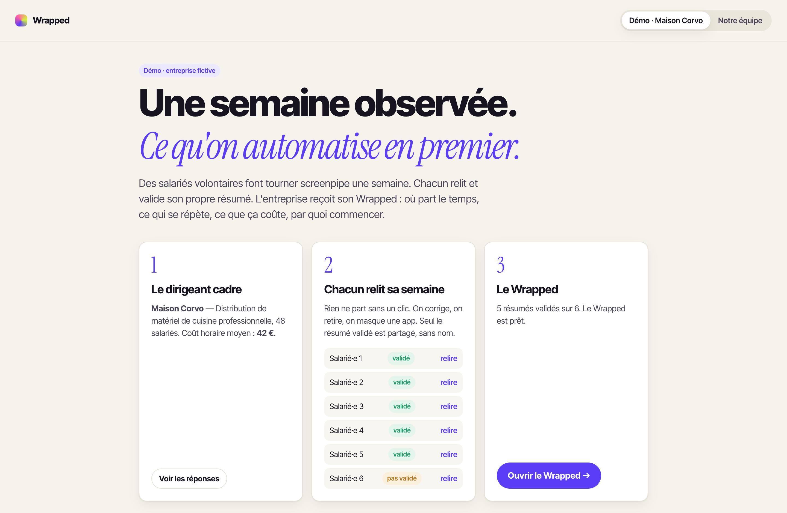
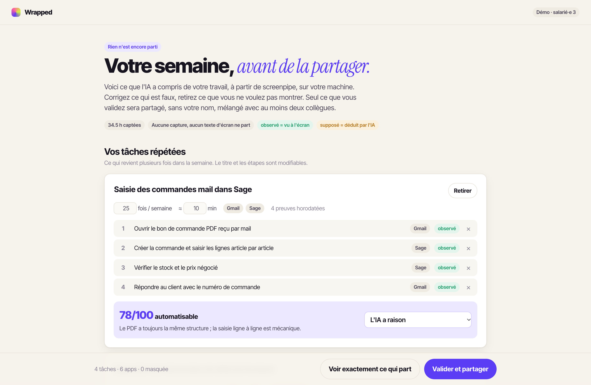
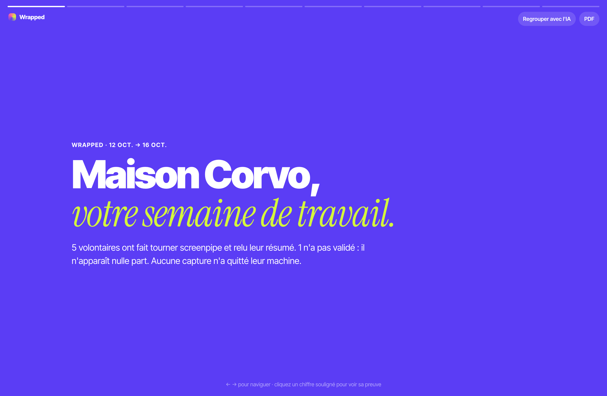

<p align="center"></p>

# DeloAI — your consulting firm and your IT team, in your pocket

**DeloAI turns a week of screenpipe recordings into an AI consulting engagement: it audits what employees repeat by hand, puts a price on it, and deploys Claude agents that do the work in the company's real software.**

screenpipe × 42 Paris hackathon, 16–18 October 2026. Pitch deck in English, live demo below, the French write-up further down.

| 1 · Audit | 2 · The office | 3 · An agent, live in Magento |
|---|---|---|
|  |  |  |
| One week of screenpipe → €71.7k a year lost to repeated tasks, the same sales report pulled 790× a week, €30.1k recoverable. Each number opens its detail; scroll for one employee, step by step. | Click an employee → the workflows the audit found in their week → open the workflow (trigger, observed steps, agent, output) → **Deploy** → **Run it live**. | A Claude agent takes a real recorded request ("cut the price of the yellow Gwyn tees below size L by 15%"), opens each product in the real back-office, types the new price, saves. Every action logged. |

## Run the demo

```sh
# 1. the test store (WebArena's Magento back-office, 9.6 GB image, once): see labs/phamphamh/boutique/README.md
sh labs/phamphamh/boutique/installer.sh
# 2. the DeloAI app + the deployed agents (one run every 5 min, in the background)
python3 labs/phamphamh/agents-nova/serveur.py      # → http://localhost:8798
```

Needs Python 3, Playwright and the `claude` CLI. The script of the 3-minute demo: [`labs/phamphamh/agents-nova/script.md`](labs/phamphamh/agents-nova/script.md).

## How it works

```mermaid
flowchart LR
  A[screenpipe on every desk<br/>clicks, pages, typed values] --> B[80/20 filter<br/>55,510 captures → 14,470 moments]
  B --> C[Claude summarises each employee<br/>tasks · steps · time]
  C --> D[The employee reviews<br/>only the validated summary is shared]
  D --> E[Merge the team<br/>19 repeated tasks, priced]
  E --> F[Workflow = the observed steps]
  F --> G[Claude agent + store tools<br/>Magento API · Playwright browser]
  G --> H[Every action logged<br/>screenshots · journal]
```



Each employee's screenpipe capture (window titles, URLs, clicks, typed values) is filtered down to the work moments that matter, then summarised by Claude into tasks, steps and time spent; the employee reviews that summary before anything is shared. A fusion step merges the validated summaries across the team, groups identical tasks by the screens they touch, and prices them (hours × 46 weeks × hourly cost) to rank what to automate. For the demo, we replayed six real people from Stanford's [WONDERBREAD](https://hazyresearch.stanford.edu/wonderbread-website) dataset (CC-BY-4.0) as a one-week screenpipe campaign at **Atelier Nova**, an online store running the [WebArena](https://github.com/web-arena-x/webarena) Magento back-office, scaled ×10 to 60 seats. Each recommended workflow is written from the observed steps and handed to a Claude agent (`claude -p`), which receives a real recorded request and acts through a small tool layer ([`boutique.py`](labs/phamphamh/agents-nova/boutique.py)): the Magento REST API to read, Playwright driving a visible Chrome window to edit. Agents run on a schedule, all on a single laptop. Only the "hands" depend on the software: the same agent works with Gmail, an ERP or any app that has an API or a connector.

**Honest limits**: the company is fictional and the volumes are ×10 a real sample of 6 people; only Magento is wired today (Gmail + Sage were tested in a sandbox, [`labs/natsuwy/tester-en-vrai/`](labs/natsuwy/tester-en-vrai/)); the live mode is slowed down on purpose so the audience can follow.

**Team**: [`docs/contribution-equipe.md`](docs/contribution-equipe.md) · adamaass (the audit), 09125o, natsuwy, tmschrib, phamphamh.

---

## Version française

### DeloAI — votre cabinet et votre ESN, dans votre poche

**Le produit** : une semaine de screenpipe chez des salariés volontaires ; chacun relit et valide son propre résumé ; l'entreprise reçoit son **Wrapped** — l'audit de son travail réel : ses tâches répétées, leur coût réel, quoi automatiser en premier — **et sa première automatisation** (skill générée, testée sur une seconde personne). L'étape suivante est déjà montrée pour de vrai : des agents Claude **déployés dans un vrai back-office Magento** y font le travail de l'équipe — rapport de ventes, changement de prix, commandes annulées — chaque action tracée, personne au clavier. Zéro consultant sur place : la mission d'un forward deployed engineer, livrée en logiciel. Le découpage : [`produit/decoupage.md`](produit/decoupage.md) ; le récit complet : [`produit/positionnement.md`](produit/positionnement.md).

Hackathon screenpipe × 42 Paris, 16–18 octobre 2026 (« Build Agents That Remember »). **La vidéo (2 min)** : à venir — dimanche (le lien sera collé ici dès qu'elle est en ligne).

**Deux démos** : ci-dessous, « L'essayer en 2 minutes » — la boucle complète sur l'entreprise fictive **Maison Corvo**, rien à installer d'autre que Python 3 ; et **DeloAI × Atelier Nova**, la démo de la vidéo — l'audit et les agents en direct dans un vrai back-office Magento, sur des données publiques (×10).

## L'essayer en 2 minutes
Rien à installer d'autre que Python 3. Double-clic sur [`labs/phamphamh/ouvrir-wrapped.command`](labs/phamphamh/ouvrir-wrapped.command) (macOS) ou :

```sh
python3 labs/phamphamh/app/serveur.py
```

→ http://localhost:8787. En haut, restez sur **Démo · Maison Corvo** (entreprise fictive complète, aucune donnée réelle) et suivez : **relecture** d'une salariée → **Wrapped** (10 slides, chaque chiffre cliquable vers ses preuves) → bouton **« Créer la skill »**. `POST /api/reinitialiser-demo` remet la démo à zéro.

| Accueil | Relecture | Wrapped |
|---|---|---|
|  |  |  |

## La démo de la vidéo — DeloAI × Atelier Nova
**Atelier Nova**, une boutique de sport en ligne fictive : ses « salariés » sont les enregistrements publics de Stanford sur de vraies tâches de back-office (WONDERBREAD / WebArena) — 6 personnes observées ×10 = 60. Des données publiques, pour ne montrer la vie de personne.

```sh
python3 labs/phamphamh/agents-nova/serveur.py
```

→ http://localhost:8798, deux écrans. **Audit** — 55 510 captures ×10 réduites à 14 470 moments de travail, puis 5 chiffres clés : 71,7 k€/an perdus en tâches répétées (19 tâches), 41 h perdues par semaine, 40 % du temps sur le seul écran Catalogue, le rapport de ventes sorti **790×/semaine**, 30,1 k€/an récupérables via **5 workflows** (dashboard d'[`adamaass`](labs/adamaass/nova-dashboard/), renommé DeloAI). **Office** — un bureau : cliquer sur un salarié (Sophie, Karim…) → ses workflows trouvés par l'audit → « Deploy workflow » → « Run it live » : de vrais agents Claude font la tâche **dans le vrai back-office Magento** ([`labs/phamphamh/boutique/`](labs/phamphamh/boutique/)), sur de vraies demandes WONDERBREAD — chaque action tracée, personne au clavier (3 des 5 workflows sont déployés).

Chaque chiffre et sa source : [`labs/phamphamh/agents-nova/script.md`](labs/phamphamh/agents-nova/script.md) ; temps humain par tâche (médianes mesurées sur les enregistrements Stanford) : rapport de ventes 23 s, changement de prix 58 s, commandes annulées 36 s. L'écran Office est en direct quand la boutique de test tourne — elle s'installe à part ([mode d'emploi](labs/phamphamh/boutique/README.md), image WebArena de 9,6 Go).

## Pour le jury — la checklist du rendu
- **Problème et utilisateur** : la mission d'un forward deployed engineer (des semaines, un profil rare, ≈ 255 k$/an de rémunération médiane) transformée en produit — utilisateur : le dirigeant et ses équipes. Repères sourcés : [`produit/positionnement.md`](produit/positionnement.md).
- **Installation / OS** : Python 3 seulement, macOS testé — « L'essayer en 2 minutes », aucune dépendance, aucun réglage.
- **Modèle et coût** : IA optionnelle ; résumé = un appel `claude -p` (sonnet) par personne ; le tri 80/20 précède tout appel ; la démo n'appelle rien.
- **Entrée fictive → sortie attendue** : démo Maison Corvo → le SKILL.md exact du bouton ([`docs/skill-exemple/`](docs/skill-exemple/)) ; exécution vérifiée dans un faux Gmail + Sage, 4 commandes fictives ([`labs/natsuwy/tester-en-vrai/`](labs/natsuwy/tester-en-vrai/)).
- **Ce qui marche / ce qui échoue / ce qui reste prototype** : marche — la boucle complète et la skill testée pour de vrai ; à corriger — l'autonomie « prépare » (la réponse reste dans le compte rendu au lieu d'un brouillon Gmail, signalé à `pack.py`) ; prototype — les connecteurs réels (MCP Gmail, ERP) à la place du bac à sable ; pas encore mesuré — le correctif double écran ([`bench/`](bench/)).
- **Contribution de chacun** : [`docs/contribution-equipe.md`](docs/contribution-equipe.md).
- **Reproduction** : vérifié depuis un clone neuf (17/10) ; pour reproduire, suivre « L'essayer en 2 minutes ».

## Ce qui est construit et vérifié
- **La boucle complète, en local** : dérush 80/20 (screenpipe → moments) → résumé des tâches → **relecture par la personne** (corriger, retirer, masquer, contester) → fusion (agrégats seulement) → Wrapped → skill.
- **La démo de la vidéo, en vrai** (18/10) : 3 agents Claude en service dans le back-office Magento (WebArena) — rapport de ventes, changement de prix, commandes annulées ; passages réussis vérifiés en visible (un prix de produit changé pour de vrai, le rapport de Karim : 7 commandes, $749.00) ; l'audit en 5 chiffres (71,7 k€/an, 41 h/sem, 40 % sur le catalogue, le rapport 790×/sem, 30,1 k€/an récupérables), 5 workflows recommandés, 3 déployés : [`labs/phamphamh/agents-nova/`](labs/phamphamh/agents-nova/) et le dashboard d'[`adamaass`](labs/adamaass/nova-dashboard/).
- **La 2e entrée, montrée** (17/10) : « la même tâche chez plusieurs personnes » — pour chaque tâche commune de la démo, la comparaison des façons de faire et des outils, et ce que la skill doit encore absorber : [`labs/09125o/deuxieme-entree/`](labs/09125o/deuxieme-entree/) (page régénérable en une commande).
- **La skill générée, déjà là** (17/10) : le fichier exact que produit le bouton « Créer la skill », testé à la main sur une commande piégée (il s'arrête et fait préparer — il n'agit pas seul) : [`docs/skill-exemple/`](docs/skill-exemple/).
- **La skill qui agit pour de vrai** (17/10) : la skill générée donnée à Claude dans un **faux Gmail + faux Sage**, sur 4 commandes fictives (propre, 2ᵉ client, référence inconnue, écart de prix). « Agit et notifie » → **4/4**, client prévenu, arrêt net sur les deux exceptions ; « prépare » → rien n'est envoyé ni validé, mais la réponse au client reste dans le compte rendu au lieu d'un brouillon (piste signalée dans `pack.py`). Banc d'essai et rapports : [`labs/natsuwy/tester-en-vrai/`](labs/natsuwy/tester-en-vrai/).
- **Les « dès que… », détectés** (17/10) : pour chaque tâche, l'événement qui la lance, la voie technique (connecteur apps → apps, appel API) et l'info à partager aux concernés — chaque ligne garde sa preuve, chiffres pris de la fusion officielle. Démo : 9 tâches → 22 déclencheurs. [`labs/09125o/declencheurs/`](labs/09125o/declencheurs/).
- **Qui a fait quoi** : le détail par personne (pour le rendu) : [`docs/contribution-equipe.md`](docs/contribution-equipe.md).
- **Tests** : `cd labs/phamphamh/fusion && python3 -m unittest test_fusion` — 10 cas de la section 6 du découpage, passent en 0,01 s.
- **La confidentialité est dans le code, pas dans une charte** : seuls les résumés validés comptent ; moins de 3 participants → pas de Wrapped ; une app ou une tâche vue chez moins de 3 personnes est fondue ; aucune capture brute ne circule ; le serveur n'écoute que sur 127.0.0.1.
- **Pas de dépendance à `claude` pour la démo** : l'IA est optionnelle (brique résumé et `fusion --ia` ; un appel LLM, remplaçable).
- **Vérifié depuis un clone neuf** (17/10) : serveur lancé, démo complète, API répondent, sans rien installer.

## L'utiliser pour de vrai (votre entreprise)
1. screenpipe tourne chez les volontaires, durée annoncée (une semaine dans notre scénario).
2. `python3 labs/phamphamh/collecteur/collecte.py --sortie donnees/<pseudo>` — tri 80/20 local.
3. `python3 labs/phamphamh/resume/resume.py` — un appel LLM (`claude -p` par défaut) → tâches répétées avec preuves horodatées.
4. Chacun relit et valide dans l'app → `labs/<pseudo>/campagne/resume-valide.json`.
5. Dès 3 validations : le Wrapped de l'équipe apparaît, et « Créer la skill » génère la première automatisation (SKILL.md).

## Travailler dans ce dépôt (l'équipe — rien à taper, tout est automatique)
Pas de chef de projet : chacun construit ce qu'il veut. **Tu n'as aucune commande à taper.**

**La première fois (5 min)**
1. Installe Claude Code : https://claude.com/download (ou l'app Claude, onglet « Code »).
2. Accepte l'invitation GitHub reçue par email.
3. Dans Claude, colle ce message :
   > Clone https://github.com/phamphamh/screenpipe-hackathon-paris dans mon dossier Documents, connecte-moi à GitHub si besoin, puis dis-moi comment ouvrir une nouvelle session Claude dans ce dossier.
4. Ouvre une nouvelle session dans ce dossier. Si Claude demande s'il peut faire confiance au dossier, réponds **oui**.

**Ensuite, à chaque fois** : ouvre Claude dans ce dossier et dis ce que tu veux faire, en français normal.
- Au démarrage, Claude récupère tout seul le travail des autres et te résume qui fait quoi.
- Il range ton travail dans ton coin (`labs/<ton-pseudo>/`) et tient à jour ta fiche (`chantiers/`) et le journal.
- **À la fin de chacune de ses réponses, tout est sauvegardé et partagé automatiquement.** Les clés API, les vidéos et les fichiers des autres sont bloqués.

(Pour les curieux : les hooks sont dans `.claude/settings.json`, les règles dans `.claude/skills/equipe/`, et les scripts dans `scripts/`. Si tu utilises Codex, il lit `AGENTS.md`.)

## Le projet
- [`produit/decoupage.md`](produit/decoupage.md) : **le découpage du produit « FDE en produit / Wrapped »** (parcours, briques, contrat de données, cas à tester, répartition, planning, pitch).
- [`produit/positionnement.md`](produit/positionnement.md) : le récit du produit, la description du rendu (prête à coller) et les repères de marché sourcés.
- [`produit/charte-campagne.md`](produit/charte-campagne.md) : consentement, anonymisation, droits des participants.
- [`produit/fusion-fronts.md`](produit/fusion-fronts.md) : décision « un seul front » (l'app + les meilleurs morceaux du front d'adamaass).

## Les notes
- [`.context/hackathon-brief.md`](.context/hackathon-brief.md) : **la fiche principale**. Elle couvre l'événement, le produit, la roadmap, les critiques, comment gagner, les mesures sur une vraie journée, la confidentialité, les étoiles GitHub des fondateurs, les infos officielles du kickoff (section 12), les idées de l'équipe (section 13), JEPA et le computer use (section 14).
- [`.context/recherche-memoire.md`](.context/recherche-memoire.md) : la recherche récente sur la mémoire des agents, la compression vidéo et l'extraction de workflows, plus les jeux de données disponibles.
- [`.context/retours-utilisateurs.md`](.context/retours-utilisateurs.md) : les plaintes et les besoins des utilisateurs de screenpipe (HN, GitHub, Product Hunt).
- [`.context/mission-windows.md`](.context/mission-windows.md) : une consigne à donner à un agent sur un PC Windows pour reproduire deux bugs Windows.

## Le reste
- [`pages/derush.html`](pages/derush.html) : une page qui montre l'architecture actuelle de screenpipe, puis la version « dérush » qu'on propose. Ouvre-la dans un navigateur.
- [`correctifs/double-ecran.patch`](correctifs/double-ecran.patch) : un correctif pour screenpipe. Quand on reste plus de 30 s sur un écran, l'autre écran se remettait à tout capturer. Il est livré avec un test qui échoue sans le correctif. Pour l'appliquer, depuis un clone de `screenpipe/screenpipe` au commit `1ebd12a` : `git apply double-ecran.patch`.
- [`bench/`](bench/) : un script qui lance la version d'origine et la version corrigée côte à côte pour les comparer. **Aucun résultat pour l'instant** : le premier essai s'est arrêté au bout de 15 s, et il faut 2 écrans pour le relancer.

## Les dates clés
- **Rendu : dimanche 18 à 14h30.** Il faut une vidéo de 2 min maximum, le lien GitHub et une courte description.
- Finale : 3 min de démo et 2 min de questions.
